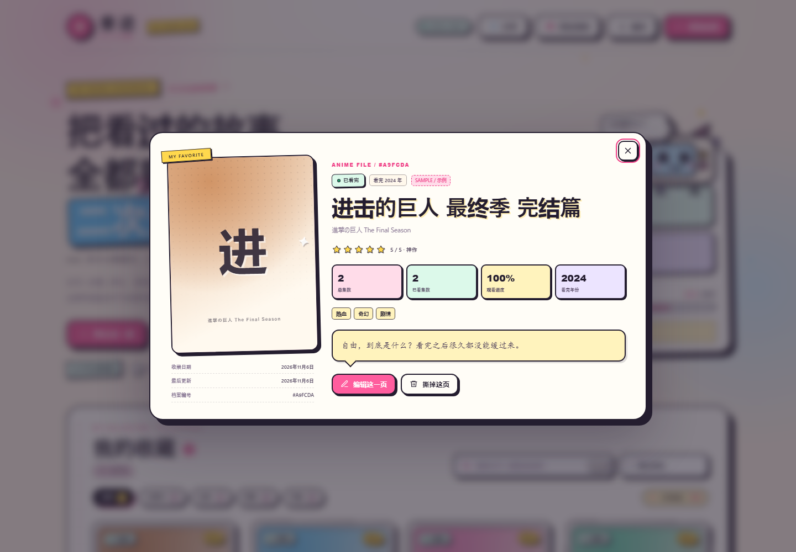
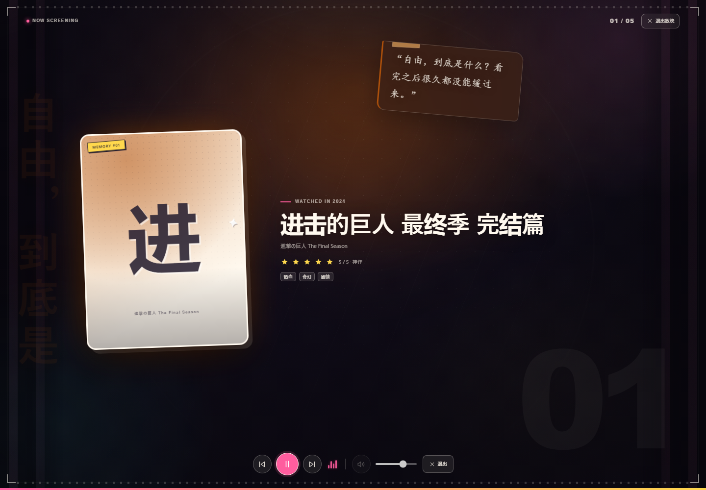
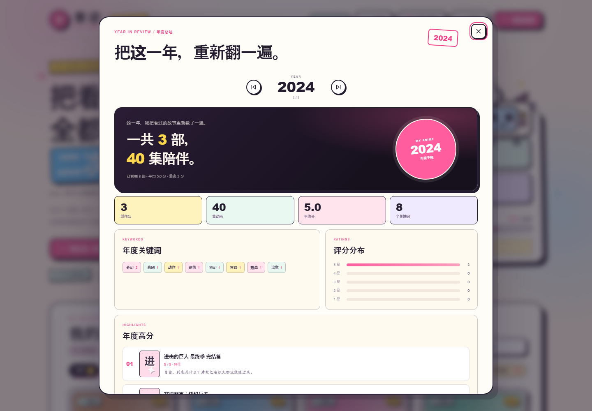

# 番迹 · Anime Archive

一本本地优先的二次元动漫手帐。厚描边、贴纸、胶带、手写短评，还有一只趴在统计栏上的小电视。记录看过的动漫、上传封面、打分写短评，也可以把收藏做成一场小型回忆放映。


## 功能

- **添加动漫**：名称、原名、看完年份、总集数、已看集数、状态、评分、标签和短评。
- **上传封面**：点击、拖拽或粘贴图片，支持 JPG、PNG、WebP、GIF。
- **整理收藏**：按状态筛选，按名字、标签、短评搜索，按最近添加、评分、名称、看完年份、集数排序。
- **详情页**：大图封面、完整资料、观看进度和短评。
- **回忆放映**：全屏轮播看过的动漫，支持本地背景音乐、随机顺序、停留时间和暂停/切换。
- **年度总结**：按看完年份汇总作品、集数、评分、关键词和高分作品，可保存年度海报。
- **临时分享**：生成一条只读公网链接，朋友输入访问码后可查看，24 小时后自动失效。
- **完整备份**：每天自动备份，包含手帐、封面和背景音乐；支持下载 ZIP、立即备份和从备份恢复。



## 回忆放映

点右上角「回忆放映」，确认停留时间、随机顺序和背景音乐后开始。

- 默认播放「已看完」的作品；没有已看完的作品时播放全部收藏。
- 背景音乐支持 MP3 / WAV / OGG / M4A，最大 30MB，只保存在本机。
- 短评会以漂浮便签和竖排大字随机出现在画面边缘。
- 空格暂停，`←` / `→` 切换，`Esc` 退出，`F` 全屏。



## 年度总结

点首页的 **「年度总结」**，按「看完年份」翻看每一年。

- 统计作品数、集数、平均分、最高分和年度关键词
- 查看评分分布、年度高分和这一年看过的全部作品
- 可在年份之间切换
- 支持保存一张 1080×1440 的年度海报，海报会拼贴年度高分作品的封面，或复制一段年度文案



## 快速开始

### 环境

- Windows 10 / 11
- Python 3.10 或更新版本
- Microsoft Edge（桌面窗口使用 Edge 的 app 模式）

项目只使用 Python 标准库，不需要安装第三方 Python 包。

```bash
git clone https://github.com/wei666-boop/fanji.git
cd fanji
python appcore/app.py
```

默认会打开 `http://127.0.0.1:8765` 并自动打开浏览器。数据保存在项目内的 `data/`。

### 桌面窗口

```powershell
pythonw appcore/desktop_app.py
```

这会启动本地服务，并打开一个没有地址栏和标签页的 Edge 应用窗口；关闭窗口后服务自动停止。

也可以生成桌面和开始菜单快捷方式：

```powershell
powershell -ExecutionPolicy Bypass -File scripts/install-shortcut.ps1
```

### 临时分享（可选）

临时分享默认优先使用 Cloudflare Quick Tunnel。仓库不包含 `cloudflared.exe`，首次使用前运行：

```powershell
powershell -ExecutionPolicy Bypass -File scripts/download-cloudflared.ps1
```

脚本会把官方 `cloudflared` 下载到 `appcore/bin/cloudflared.exe`。如果没有这个文件，分享功能会退回 `localhost.run` 的 SSH 隧道，速度较慢。

> 临时分享依赖第三方隧道服务，不保证可用性和速度。分享期间电脑和窗口必须保持开启，链接 24 小时后失效。

## 备份与恢复

- 自动备份每天最多一次，保留最近 7 份完整 ZIP。
- 完整备份包含 `anime.json`、封面、背景音乐和音乐信息。
- 恢复会覆盖当前手帐、封面和背景音乐；恢复前会自动再备份一次当前数据。
- 旧版 JSON 备份仍然支持导入。

备份文件位于 `data/backups/`。

## 数据与隐私

```
data/
├─ anime.json       手帐数据
├─ images/          封面
├─ music/           背景音乐
├─ music.json       音乐信息
├─ shares/          临时分享快照（自动清理）
└─ backups/         完整备份 .zip
```

- 平时所有数据只保存在本机。
- 主动开启临时分享时，会生成一份只读快照，通过第三方隧道提供给拿到链接和访问码的人；停止分享后清理。
- 分享页不暴露新增、编辑、删除接口，也不包含背景音乐。
- 公开仓库不包含任何真实收藏、用户封面、背景音乐或备份。

## 开发与测试

```bash
python -m unittest discover -s tests -v
ruff check appcore tests
```

Windows 下 CI 会使用临时数据目录启动真实服务，验证健康检查、创建条目、完整备份导出和恢复；同时运行 Ruff 和 JavaScript 语法检查。

## 项目结构

```
appcore/             Python 服务、桌面启动器、分享服务
static/              页面、样式、脚本（含年度海报 poster.js）
scripts/             快捷方式和 cloudflared 安装脚本
tests/               smoke tests
docs/screenshots/    使用示例数据生成的公开截图
data/                本地数据（被 .gitignore 忽略）
```

## 已知限制

- 目前桌面窗口仅支持 Windows。
- 临时分享依赖 Cloudflare Quick Tunnel / localhost.run；国内网络环境可能需要更换隧道方案。
- 分享访问码是 6 位数字，适合临时、低风险的分享，不适合敏感资料。
- 项目没有云端同步；跨设备请使用完整 ZIP 备份。

## 第三方与素材

- 可选的 `cloudflared` 由 Cloudflare 提供，遵循 Apache License 2.0；仓库不重新分发该二进制。
- 临时分享的 fallback 使用 `localhost.run` 服务。
- 示例数据中的动漫名称归各自权利人所有；项目不包含任何动画封面、截图或音乐文件。
- 封面、音乐和短评由使用者自行提供，使用者需自行确认其使用权。

## License

MIT。详见 [LICENSE](LICENSE)。

## 贡献

欢迎提交 issue 和 pull request。请先阅读 [CONTRIBUTING.md](CONTRIBUTING.md)。
